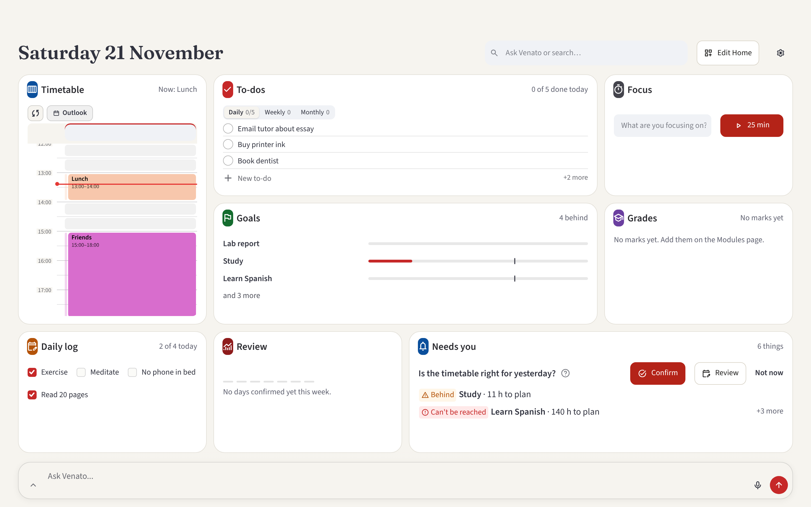
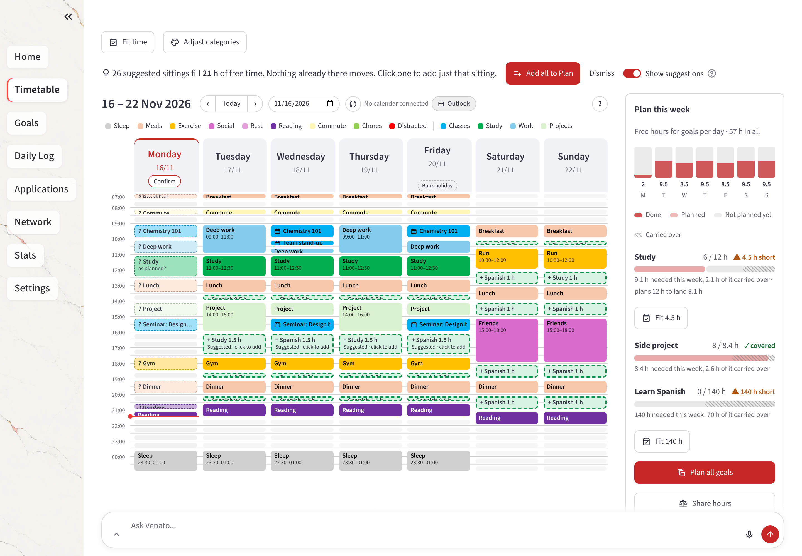
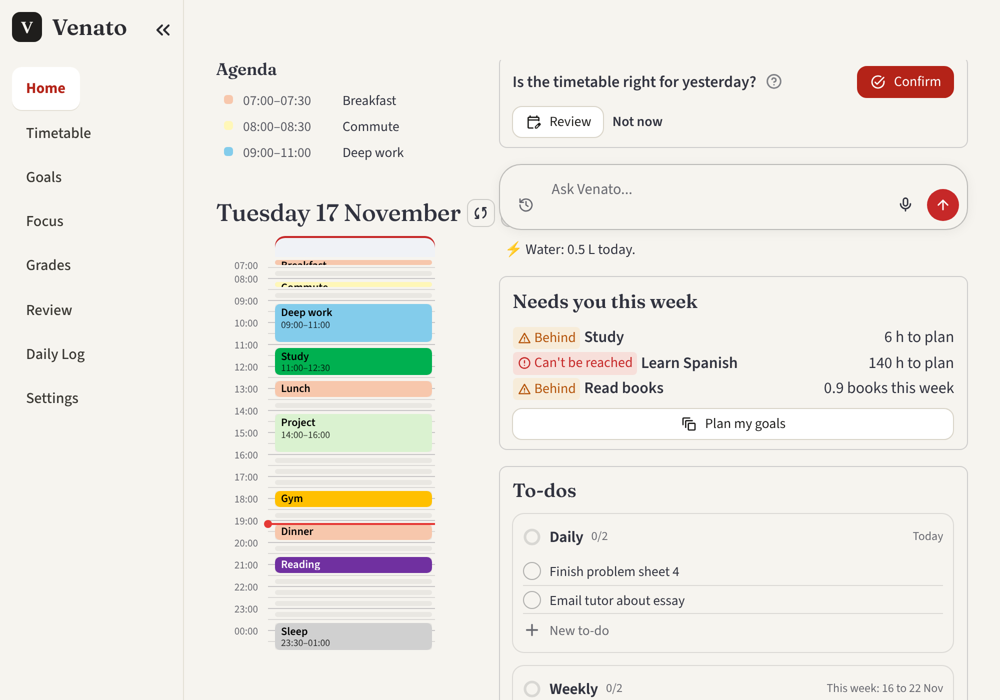
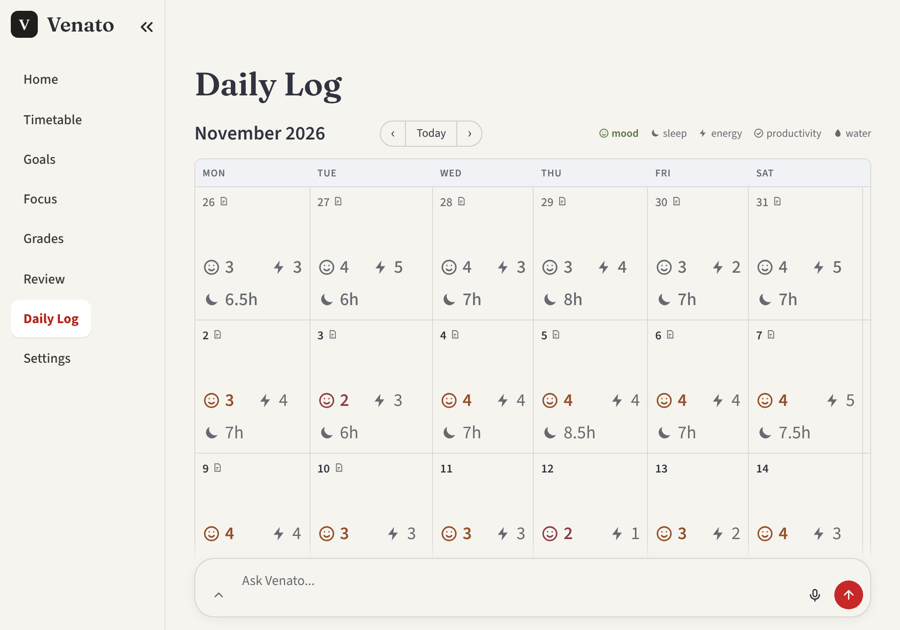
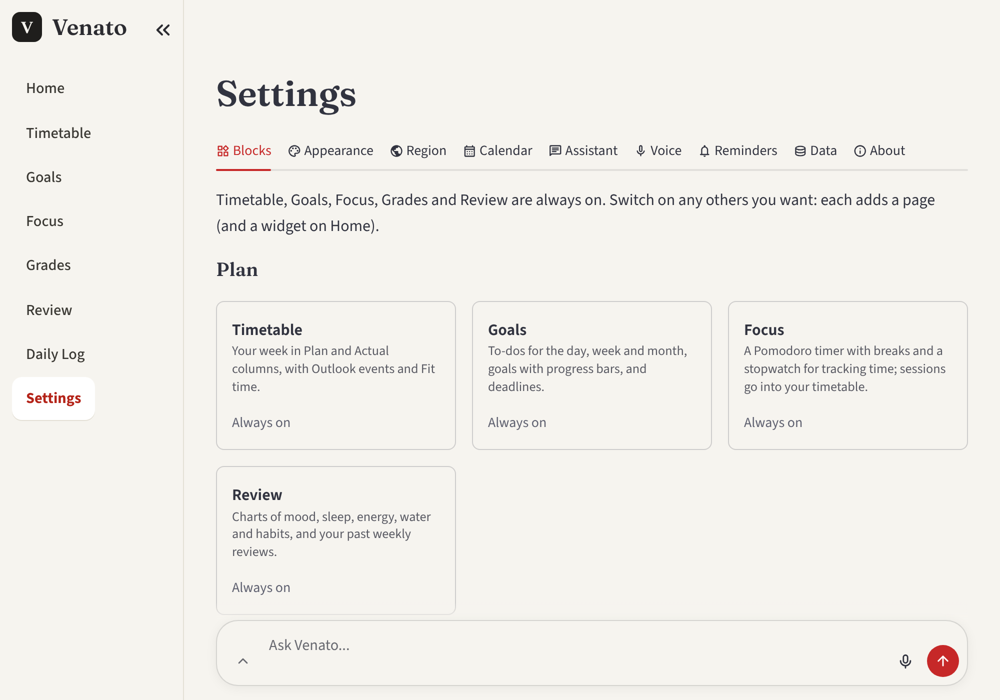
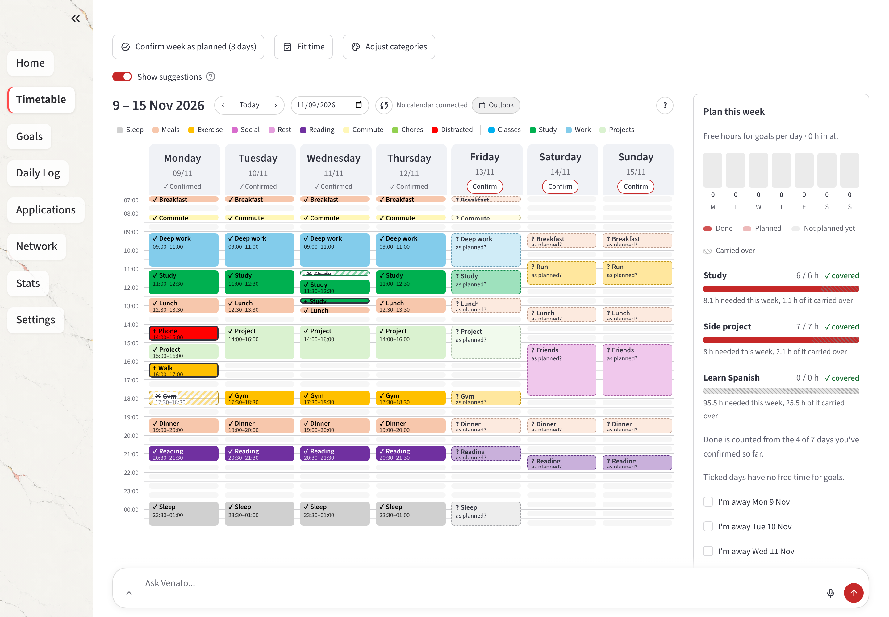
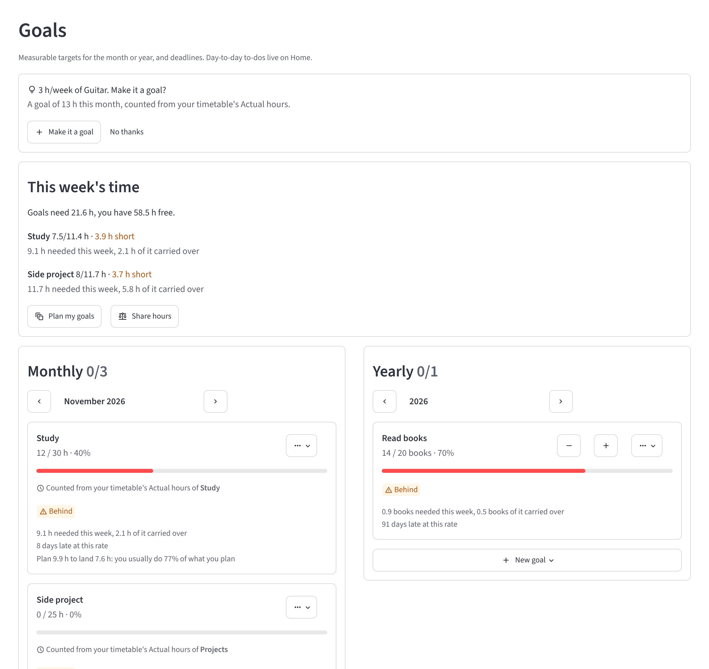

<!-- TODO: demo.gif -->

<p align="center">
  
</p>

<h1 align="center">Venato</h1>

<p align="center">
  <strong>A private, offline planner for your Mac or PC: plan your week, log what actually happened, and see the gap.</strong><br>
  For university students who want their timetable, deadlines, goals, focus and grades in one place, offline.
</p>

<p align="center">
  <a href="LICENSE"></a>
  <a href="https://github.com/spencertomj1-hue/venato-app/releases/latest"></a>
  <a href="https://github.com/spencertomj1-hue/venato-app/actions/workflows/tests.yml"></a>
  <a href="https://github.com/spencertomj1-hue/venato-app/commits/main"></a>
  <a href="https://github.com/spencertomj1-hue/venato-app/stargazers"></a>
  
  
</p>

<p align="center">
  
</p>

<p align="center">⭐ <strong>Star the repo if you find it useful.</strong> It helps other people find it.</p>

*Venato* comes from the Latin *venari*, to hunt or track down. No summit, just the climb.

## Why this?

- **Plan, then adjust, then confirm.** Your Plan for a day is locked in when the day starts and copied into its Actual, so you never log your day twice: move, stretch or delete blocks as the day really goes, then confirm it at the end. The weekly review then tells you how much of your plan you followed, per category, counting only the days you've confirmed. Notion and Daylio don't do that out of the box.
- **Your data never leaves your computer.** No account, no server, no cloud sync. Everything is one SQLite file in your data folder, the app only listens on `127.0.0.1`, and voice is transcribed locally.
- **Everything in one place.** Timetable, to-dos, deadlines, goals, focus sessions and grades, with a daily journal with habits (and optional sleep and water), all linked: tick a habit and the goal it counts towards moves; a deadline shows on the timetable and gets a reminder.
- **Optional Claude assistant.** Type or say "Fit 6 hours of revision into next week around my lectures" or "Add a note to today's journal and tick reading". It works through a fixed set of Venato actions, previews anything destructive for you to confirm, and is off unless you switch it on. Everything also works by hand.

## Features

**Blocks.** Venato is built from blocks, and every one can be switched on or off in Settings → Blocks. A new setup starts with Timetable, Goals (to-dos and deadlines too), Focus, Review and the Daily Log, and students also get Modules. Each brings its own page, Home tiles and assistant skills. **Home is the way round the app** (there is no sidebar): every tile opens its page, and each page has "← Home" (or Esc) and small shortcut tiles to the others. Settings is the gear top right, and search / Ask is the bar at the top of Home. On a laptop Home fits one screen: each tile is a summary and opens its page for the rest. Press **Edit Home** to move tiles, make them Small, Wide, Large or Tall, remove them (their data stays) or add hidden ones from "Add a tile".

| Block | What it does |
|---|---|
| **Timetable** | Weekly plan in 30-minute slots with a Plan / Actual switch, calendar events, and fit-time planning. |
| **Goals** | Goals with deadlines and a pace, to-dos and deadlines. |
| **Focus** | Pomodoro or stopwatch with auto breaks; on Home, a dial you press to start, filling to a daily aim; sessions of 15+ minutes go into the Actual timetable. "focus 50 on essay". |
| **Modules** | One card per module, with its lectures, deadlines, assessments, study hours and its own timetable colour; a page for each module, where a deadline's **Plan** books the hours for it. Also grades: weighted assessments, the mark needed for your target, UK classification or US GPA. "got 68 in acp coursework". |
| **Review** | Weekly review, time planned vs done, charts and history. |
| **Daily Log** | A journal for each day, and habits with streaks. Sleep and water are optional extras (Settings → Daily Log). |

**Planning**
- **Weekly timetable** in 30-minute slots with a **Plan / Actual** switch. A day's Plan is locked when the day starts and copied into its Actual; after that you change the Actual as the day goes, and confirm it at the end (Confirm under the day, "Confirm week", or Home's "Is the timetable right for today?"). Review and goals count confirmed days only and say how many. Drag to add blocks; point at a block to select it (a thin red outline), click for its details, drag it to move it or drag its top or bottom edge to stretch or shrink it; ⌘/Ctrl+C and ⌘/Ctrl+V copy and paste, Backspace deletes; with no category picked, drag a box (or Shift-drag) to select several, Shift- or ⌘/Ctrl-click to add one, then move, copy, paste or delete them together; ⌘Z / Ctrl+Z to undo.
- **Colour-coded categories** in groups ("Life", "Work"), with activities that pick their category automatically ("Lunch" goes to Meals).
- **Fit time:** say what, how many hours and which days; Venato finds free gaps around your blocks and calendar events and previews the sittings before adding them.
- **To-dos** for today, this week and this month, in the style of Apple Reminders: drag to reorder, notes, repeating to-dos.
- **Goals** with a deadline you pick on a small calendar (with markers for 2 weeks from now, the end of the month, a month from now, the end of the year and a year from now, and one-click "End of the year" / "In a year"), updated by hand, linked to a habit, or counted from your timetable's Actual hours in a category (or one activity). Each goal's card has a state badge and a small pace chart: progress so far, an even pace to the target, where you'll end up at your recent rate, and today. Beside them, "Where this week's N h free go" splits the week's free time between your goals in one bar, and goals that can't be finished in time get a card offering to lower the target, move the deadline or take hours from a lower goal.
- **Goals that know your week:** beside the timetable, a "Plan this week" panel shows your free hours per day, each hours goal's week as a bar (done, planned, not planned yet, carried over) with "Fit N h", "Plan all goals" and "I'm away" for each day. When goals are short, the grid draws where their time would fit as dashed suggested sittings in free gaps: click one to add just that sitting, "Add all to Plan", or dismiss them for the week (Show suggestions turns them off). Venato works out your free time (timetable hours minus calendar events and other blocks), what each goal needs this week including hours carried from slow weeks, whether you're on track, behind, slipping or can't make it, and when you'll finish at your recent pace. It plans extra for time that usually slips, shares a crowded week between goals by priority, offers to lower a target, carry it into next month or borrow hours from a lower goal, suggests goals from what you already do, and nudges you mid-week if what's planned won't cover a goal.
- **Deadlines** with countdowns, reminders the day before and on the day, and "Make time" to plan hours for them.

**Home**
- Today's timetable (its Actual: the Plan as locked this morning, with your changes), stretched to fill the window, and an end-of-day prompt: "Is the timetable right for today?" with **Confirm** or **Review**.
- **Home is yours to arrange**, like a phone's home screen: press Arrange (top right), then move, resize, hide or add widgets.
- **Needs you:** days to confirm, goals that are behind or short of time (each with its state, "N h to plan", its bar with a "should be here by today" tick, and Plan my goals), deadlines this week with no plan, and the odd one-off card. The tile shows the first three; tap it for all of them. Nothing to do: "Nothing needs you."
- **To-dos** in one card with a Daily / Weekly / Monthly switch, then deadlines, habits and search. A widget with nothing to show (no habits, no marks, no deadlines…) isn't drawn.

**Tracking**
- **Daily log (optional):** a journal box for each day, with a month calendar marking the days you wrote. Click a day to open it and tick habits.
- **Habits (optional):** daily or with a weekly target ("Gym 3 times a week"), with current and best streaks.
- **Journal (optional):** each day's notes, with a daily prompt and a searchable list of past entries.
- **Review:** time planned vs done, goal pace and past weekly reviews; with Daily Log on, habit completion rates, and sleep and water charts if you track them.
- **Weekly review:** pops up after 7pm on Sunday with plan followed, time per category, goal pace, to-dos, deadlines and two questions to reflect on; with Daily Log on it adds habits and the journal (and sleep and water vs last week, if you track them).

**Everything else**
- **Search** across to-dos, goals, deadlines, habits, journal, timetable, calendar events and past reviews.
- **Calendars (optional, read only):** Outlook, Google, Apple (iCloud) or any .ics calendar shows in your Plan, synced every 15 minutes.
- **Reminders:** desktop notifications a few minutes before each planned block or event.
- **Undo** for deletes and overwrites, for two minutes.
- **Backups:** automatic daily backups (keeps 30) to any folder, e.g. iCloud Drive or OneDrive, plus CSV export/import and journal download.
- **Settings:** time zone, week start, 12/24-hour clock, date format, litres or US fl oz, timetable hours, light/dark/system theme and four text sizes.
- **Accessible:** keyboard and screen-reader support, and every page passes WCAG AA contrast in light and dark.
- **Update check:** once a day, a banner if a new release is out (can be turned off).

## Screenshots

*All screenshots use made-up demo data.*

| Weekly timetable: suggested sittings and the planner | Asking Claude |
|---|---|
|  |  |
| **Daily log** | **Settings** |
|  |  |
| **Last week as one timeline: confirmed, corrected, assumed** | **Goals: pace charts and where the week's free time goes** |
|  |  |

## Quick start

**Just want the app?** Download it from [Releases](https://github.com/spencertomj1-hue/venato-app/releases/latest): `Venato-Setup.exe` (Windows) or `Venato.dmg` (Apple silicon Mac). They aren't code-signed, so the first launch needs **More info → Run anyway** on Windows, or **System Settings → Privacy & Security → Open Anyway** on a Mac.

**From source (Mac).** Needs [Python 3.13](https://www.python.org/downloads/) (`brew install python@3.13`) and Git.

```bash
git clone https://github.com/spencertomj1-hue/venato-app.git
cd venato-app
./setup.sh
```

`setup.sh` makes a `.venv`, installs the pinned packages and builds **Venato.app** in Applications. Run it again after `git pull`.

**From source (Windows).** Same, but in PowerShell the last step is:

```powershell
powershell -ExecutionPolicy Bypass -File .\setup.ps1
```

It adds a Venato shortcut to the Start menu and desktop.

**Run it in a browser (any OS, incl. Linux).** Handy for development:

```bash
git clone https://github.com/spencertomj1-hue/venato-app.git && cd venato-app
python3.13 -m venv .venv && .venv/bin/pip install -r requirements.txt
.venv/bin/streamlit run app.py
```

The first install downloads about 1 GB of packages; the speech model (about 470 MB) only downloads the first time you use the mic.

## Getting started

The first time Venato opens, a short setup starts. It adds things and never deletes any, every step except Welcome can be skipped, and **Skip setup** leaves you with a blank app. Run it again any time from Settings → About.

**Everyone.** Venato starts empty: no categories, habits or goals. Setup asks what you want to get done (a few words, a date and how you'll track it), suggests what to track for each (a habit, a timetable category, sleep or water, all unticked until you pick them), lets you add your own, and lays out your first week.

**If you're a student.** Press "I'm at uni" on Welcome and you get two more steps after it:
1. **Connect your calendars.** Paste your university's published Outlook timetable link and your Canvas Calendar Feed link. Both are optional. Lectures go on the timetable, assignments become deadlines, and Venato finds your modules from them.
2. **Your modules.** Tick the ones to add, rename them if you like, and say how many hours a week each one gets (6 by default). Each gets its own timetable colour and a card on the Modules page.

The steps are Welcome, Connect your calendars, Your modules, Your goals, What would you track? and Your first week. If you're not a student, it's Welcome, Your goals, What would you track? and Your first week.

Both links are read only, and are kept in your system's secret store, never in a file.

**After setup.**
- **Modules** (students): a card per module; click one for its lectures, deadlines, marks and hours. On a deadline, press **Plan** to book hours for it: Venato makes an hours goal that finishes the day before it's due.
- **Plan.** Put what you intend to do on the timetable (Plan). When the day starts the Plan is locked and copied into Actual; change the Actual as the day goes, then confirm it.
- **Home.** Click any tile to open its page; "← Home" or Esc brings you back. Press Edit Home to move, resize, remove or add tiles. Reset puts them back.
- **Send feedback.** The link in Settings → About opens a short form in your browser with your version and system filled in. Nothing is sent from the app. After two weeks, Needs you asks once how it's going.

## Setting up the optional bits

**Claude assistant.** Off until you switch it on (first-run setup or Settings → Assistant). It uses your own Claude access, one of:
- an **Anthropic API key**, pasted into Settings → Assistant (kept in your system's secret store), or set as `ANTHROPIC_API_KEY`; or
- **[Claude Code](https://docs.claude.com/en/docs/claude-code)** signed in with your Claude account (`claude auth login`). Venato finds it automatically.

Claude can only use Venato's own actions. It has no access to your files, terminal or the web.

It runs on **Claude Haiku 5.5** at low effort, kept open between messages, and replies appear as they're written. Short everyday messages ("drank 500ml", "tick gym", "slept 7h", "done finish essay" (sleep and water need switching on in Settings → Daily Log)) are handled straight away without asking Claude; their replies start with ⚡ (switch off in Settings → Assistant → Quick commands). To use a different model, set `"model"` (and optionally `"effort"`) in `venato_config.json`.

**Outlook calendar.** In Outlook on the web: Settings → Calendar → Shared calendars → Publish a calendar, pick **Can view all details**, copy the **ICS** link and paste it into Settings → Calendar. The link is stored in the macOS Keychain / Windows Credential Manager. Anyone with that link can see your calendar, so unpublish it in Outlook to revoke it. Some universities and workplaces block publishing.

**Google and Apple calendars.** Settings → Calendar → Other calendars. Google: calendar.google.com → Settings → your calendar → Integrate calendar → **Secret address in iCal format**. Apple: Calendar on a Mac or iCloud.com → Share Calendar → **Public Calendar** → copy the link. Links are kept in the secret store like Outlook's.

## Privacy

- **Stays on your computer:** all your data (in `~/Library/Application Support/Venato/` on a Mac, `%APPDATA%\Venato` on Windows, `~/.local/share/Venato` on Linux, never inside the repo), voice recordings and their transcripts, and chat history (memory only, never saved).
- **Leaves your computer only if you turn it on:** chat messages go to Anthropic, each with a short snapshot of today (your timetable for today and tomorrow, today's log, habits, current to-dos, open deadlines, plus a line from each block you've switched on, such as this week's modules) so Claude can answer without looking things up, plus anything else Claude looks up; published calendars you add are downloaded from Microsoft, Google, Apple or wherever they're hosted; the daily update check asks GitHub for the latest version number; Send feedback only opens a form in your browser, so nothing is sent unless you submit it.

Nothing else is sent anywhere.

## Troubleshooting

| Problem | Fix |
|---|---|
| "Unidentified developer" on a Mac | Right-click Venato → Open → Open (once). |
| `setup.sh` says Python 3.13 is missing | `brew install python@3.13` (or python.org), then run `./setup.sh` again. |
| Chat says Claude isn't logged in | `claude auth login`, then Settings → Assistant → Check again. |
| Chat can't find Claude Code | Set `claude_path` in `venato_config.json` in your data folder (see `venato_config.example.json`). |
| Mic records silence | Allow Venato in System Settings → Privacy & Security → Microphone. |
| You moved the cloned folder | Run `./setup.sh` again to rebuild Venato.app. |

## Tech stack

- **Python 3.13** with **[Streamlit](https://streamlit.io)** for the UI, plus custom JS/CSS components (timetable, to-dos, chat)
- **SQLite** for storage, **Altair** (comes with Streamlit) and **pandas** for charts
- **[pywebview](https://pywebview.flowrl.com)** for the native desktop window
- **[Claude Agent SDK](https://docs.claude.com/en/docs/claude-code/sdk)** for the optional assistant
- **[faster-whisper](https://github.com/SYSTRAN/faster-whisper)** for on-device speech to text
- **icalendar** / **recurring-ical-events** for calendars, **keyring** for secrets
- **PyInstaller** and **Inno Setup** for the installers, **GitHub Actions** for tests on Windows, macOS and Linux

## Roadmap

From the "Ideas for later" list in [`HANDOVER.md`](HANDOVER.md):

- [ ] Timetable blocks in CSV export/import (to-dos and goals already have CSVs)
- [ ] "Carry over unfinished" to-dos in the UI (the store function exists)
- [x] Streaming chat replies
- [x] Goals connected to the weekly timetable (capacity, pace, debt, honest forecasts, competing goals)
- [ ] Signed and notarised Mac app
- [ ] A Linux installer (it runs from source today, in the browser)

Got an idea? [Open an issue](https://github.com/spencertomj1-hue/venato-app/issues/new/choose).

## Contributing

Bug reports, ideas and pull requests are welcome. See [CONTRIBUTING.md](CONTRIBUTING.md) to get set up, and [HANDOVER.md](HANDOVER.md) for how the code fits together. Please never commit real personal data.

## License

[MIT](LICENSE) © Thomas Spencer

⭐ If Venato helps you, a star on GitHub is the easiest way to say thanks.
